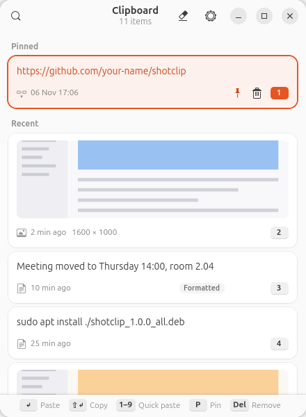
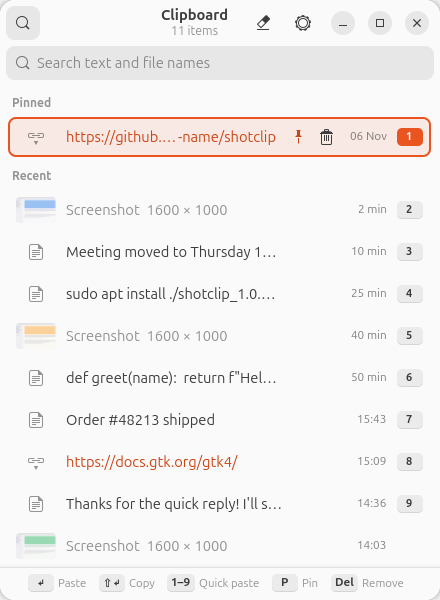
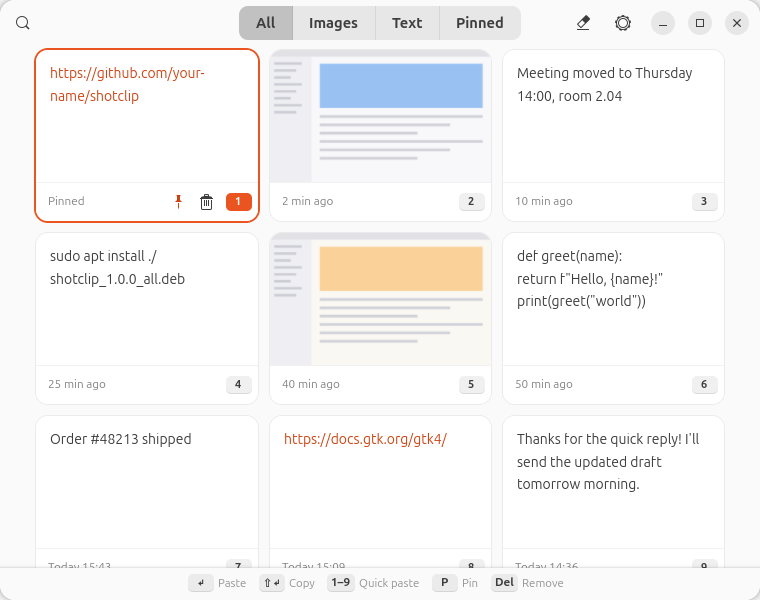
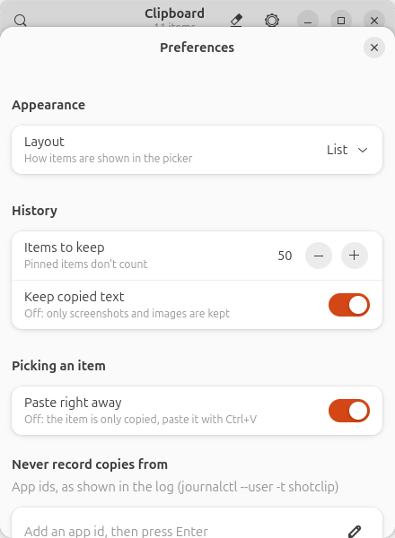

# ShotClip

Clipboard history for GNOME on Wayland, like Windows' Win+V. Press
**Super+V** to see the screenshots, screencasts, images and text you copied,
pick one, and it is pasted into the app you were using.

<p align="center">
  
  
</p>
<p align="center">
  
</p>

- **Screenshots, images and text**: new screenshots (Print Screen) show up on
  their own, and so does anything you copy in any app.
- **Screencasts as MP4**: screen recordings (Print Screen, then the camera
  button) show up too, are converted from WebM to MP4 so every app can open
  them, and are pasted as a file.
- **Paste in one keystroke**: Enter, a click or 1–9 pastes into the previous
  app; text copied with formatting can be pasted with it.
- **Pin, search, remove**: pinned items are never dropped from the history.
- **Three layouts**: List, Compact rows or Tiles, picked in Preferences.
- **Light, dark or automatic**: follows the system style, or force one.
- **Private by default**: copies that password managers mark as secret are
  never stored, and you can exclude any app.

## Why it works this way

Wayland doesn't let background apps read the clipboard. ShotClip ships a
small GNOME Shell extension (the shell *is* allowed to see clipboard changes)
that forwards each copy to the ShotClip app over D-Bus, sets the clipboard
when you pick an item and sends the paste keystroke. The app itself is a
GTK 4 / libadwaita program in a single Python file.

## Requirements

- GNOME Shell 48, 49 or 50 on Wayland (for example Ubuntu 25.04 or later)
- Python 3 with PyGObject, GTK 4 and libadwaita 1.5 or later:
  `python3-gi gir1.2-gtk-4.0 gir1.2-adw-1 gir1.2-gdkpixbuf-2.0`
- Optional, for screencasts: `ffmpeg` (converts WebM to MP4 and makes the
  previews; without it, recordings are kept as WebM with no preview)

## Install

### From the PPA (Ubuntu 26.04, recommended)

```bash
sudo add-apt-repository ppa:romerpt/shotclip
sudo apt install shotclip
```

Then **log out and back in once** (see below). Updates arrive with your
normal system updates.

### From the .deb (Ubuntu, Debian)

Download `shotclip_<version>_all.deb` from the
[Releases](https://github.com/romerpt/shotclip/releases) page, then:

```bash
sudo apt install ./shotclip_1.1.0_all.deb   # use the file name you downloaded
```

Then **log out and back in once**: GNOME only loads a newly installed shell
extension at login on Wayland. After that, press Super+V.

The package installs ShotClip for every user of the computer. Super+V and the
shell extension are switched on for you during the install, and for other
users the first time they log in.

To remove it (your history stays in `~/.local/share/shotclip`):

```bash
sudo apt remove shotclip
```

### Without root (any distribution with GNOME 48+)

```bash
git clone https://github.com/romerpt/shotclip.git
cd shotclip
./install.sh
```

This installs into your home folder only (`~/.local`), and offers to install
the missing packages with `sudo apt` if needed. Log out and back in once, as
above. To remove it, run `./uninstall.sh`.

> Use one method, not both. A home-folder install takes precedence over the
> .deb, so run `./uninstall.sh` before switching to the package.

## Use

Press **Super+V**. The picker closes when you pick an item, press Esc or
click elsewhere.

| Key | Action |
|---|---|
| Enter, click, or 1–9 | Paste the item into the app you were using |
| Shift+Enter | Copy only (paste it yourself with Ctrl+V) |
| Ctrl+Enter | Paste with formatting (items marked "Formatted"; for apps that accept HTML, such as LibreOffice, browsers and mail) |
| Arrow keys, Home, End, Page Up/Down | Move the selection |
| P | Pin or unpin (pinned items are never removed) |
| Space | Play a screencast (or click its ▶ button) |
| C | Convert a WebM screencast to MP4 (when automatic conversion is off) |
| Del | Remove the item |
| Ctrl+F | Search text and file names (arrows and Enter still work while typing) |
| Ctrl+, | Preferences |
| Ctrl+Shift+Del | Clear all unpinned items (asks first) |
| Esc | Close the search, then the picker |

Notes:

- Text copied with formatting (web pages, LibreOffice, mail) keeps it: Enter
  pastes plain text, which works everywhere, and Ctrl+Enter pastes the
  formatting into apps that accept HTML.
- When a copy has both text and an image (a spreadsheet range, for example),
  the text is kept.
- GNOME's screenshot tool both saves a file and copies the image; ShotClip
  keeps only one of them.

## Screencasts

GNOME's screenshot tool records the screen to `~/Videos/Screencasts` but
never puts the recording on the clipboard. ShotClip watches that folder:

1. A new recording appears in the picker with its preview and a progress
   bar showing how much of the conversion is done.
2. WebM recordings are converted to MP4 (H.264, AAC audio) with ffmpeg, at
   low priority, and the MP4 is saved **next to the original**
   (`Screencast From … .mp4`). The WebM is kept. If that folder isn't
   writable, the MP4 goes to `~/.local/share/shotclip/videos/`.
3. Its ▶ button (or Space) plays it inside the picker; from the player
   you can paste it or open it in your video player.
4. Picking it puts the MP4 file on the clipboard, like copying it in Files:
   paste it into Files, a browser upload, a chat or a mail.

Conversion can be turned off in Preferences › Screencasts › Convert to MP4.
Recordings then stay WebM, and you can convert one when you need it with
its convert button or the C key.

Video files you copy in Files also show up in the history (WebM ones are
converted the same way). Removing a screencast from the history, or clearing
it, never deletes the video files. The first time, the three newest
recordings already in the folder are added.

## Layouts

Pick one in **Preferences › Appearance › Layout** (gear button or Ctrl+,).

| Layout | Best for |
|---|---|
| **List** (default) | A mix of text and screenshots: cards with three lines of text or a wide image preview |
| **Compact rows** | Mostly text: one line per item, about a dozen on screen, search always open |
| **Tiles** | Mostly screenshots: a three-column grid with All, Images, Text and Pinned filters |

## Preferences



The Preferences dialog (gear button or Ctrl+,) changes:

- **Layout** of the picker
- **Style**: Follow system, Light or Dark
- **Items to keep**: unpinned items kept in the history
- **Keep copied text**: turn off to keep only screenshots and images
- **Keep screencasts** and **Convert to MP4**
- **Paste right away**: turn off to only copy the picked item
- **Never record copies from**: apps whose copies are ignored

Everything is stored in `~/.config/shotclip/config.json`, which you can also
edit by hand; changes apply without a restart.

| Key | Default | Meaning |
|---|---|---|
| `layout` | `"list"` | `"list"`, `"compact"` or `"tiles"` |
| `theme` | `"auto"` | `"auto"` (follow the system), `"light"` or `"dark"` |
| `max_items` | `50` | Unpinned items to keep |
| `capture_text` | `true` | Record copied text |
| `auto_paste` | `true` | Paste after picking (otherwise copy only) |
| `exclude_apps` | `[]` | App ids whose copies are never recorded, e.g. `["org.keepassxc.keepassxc"]` |
| `watch_dirs` | `[]` | Screenshot folders; empty means the GNOME Screenshots folder, found automatically |
| `import_existing` | `20` | Screenshots imported on the very first run |
| `capture_videos` | `true` | Record new screencasts |
| `convert_videos` | `true` | Convert WebM screencasts to MP4 (needs ffmpeg) |
| `video_dirs` | `[]` | Screencast folders; empty means the GNOME Screencasts folder, found automatically |

To find an app's id, copy something in it and look at the log
(`journalctl --user -t shotclip`): each entry ends with `from <ids>`, and any
of those ids works.

<br clear="right">

## What gets changed on your system

- **Super+V** opens ShotClip. GNOME's own Super+V shortcut (show the
  notification list) moves to **Super+M**, which GNOME already uses for it.
- The GNOME Shell extension `shotclip@shotclip.github.io` is installed and
  enabled.
- ShotClip starts in the background at login, so copies are recorded.

Removing ShotClip (`sudo apt remove shotclip` or `./uninstall.sh`) undoes all
of this and gives Super+V back to GNOME.

## Privacy

- Nothing leaves your computer. ShotClip makes no network connections.
- The history is stored **unencrypted** in `~/.local/share/shotclip/`: text in
  `history.json`, images in `images/`, screencast previews in
  `video-thumbs/`. Screencasts stay where they were recorded.
- Copies that password managers mark as secret (`x-kde-passwordManagerHint`,
  used by KeePassXC and others) are never stored. Add other apps to "Never
  record copies from".
- Remove anything sensitive with Del, or clear the history with
  Ctrl+Shift+Del.

## Troubleshooting

| Problem | Fix |
|---|---|
| Super+V does nothing | Log out and back in once after installing. Check Settings › Keyboard › Custom Shortcuts for "ShotClip". |
| "Can't copy: the ShotClip shell extension isn't loaded" | Log out and back in. Check `gnome-extensions info shotclip@shotclip.github.io` shows `State: ACTIVE`. |
| Copied text doesn't appear | Make sure "Keep copied text" is on and the app isn't excluded. The log shows each copy. |
| Screenshots don't appear | If you save them somewhere other than Pictures/Screenshots, set `watch_dirs`. |
| Screencasts stay WebM, no preview | Install ffmpeg (`sudo apt install ffmpeg`); the log shows conversion errors. |
| Pasting a screencast does nothing | The app must accept pasted files (Files, browsers, chat and mail apps do). Paste with Ctrl+V if the automatic paste is ignored. |
| You still see an old version | The background copy keeps running the old code: run `shotclip --quit`, then press Super+V. |

Logs: `journalctl --user -t shotclip`

## Command line

```
shotclip                 open the picker (starts ShotClip if needed)
shotclip --daemon        start in the background without opening the picker
shotclip --quit          stop the running ShotClip
shotclip --setup         turn on Super+V and the shell extension for this user
shotclip --remove-setup  undo --setup
shotclip --version       print the version
```

## Building

| Command | Output |
|---|---|
| `./make-deb.sh` | `dist/shotclip_<version>_all.deb`, the Debian/Ubuntu package |
| `./make-installer.sh` | `dist/shotclip-installer.sh`, a single self-extracting file that runs `install.sh` (`--uninstall` to remove) |
| `./make-ppa.sh` | `dist/ppa/`, the signed source package for the Launchpad PPA (`--upload` to send it) |
| `gnome-extensions pack extension/ --out-dir dist` | The extension zip for extensions.gnome.org |

The version comes from `VERSION` in `shotclip.py` and must match
`debian/changelog`. How to publish a release: [docs/PUBLISHING.md](docs/PUBLISHING.md).

## Project layout

```
shotclip.py              the app: history, picker window, preferences
extension/               GNOME Shell extension (clipboard access, paste)
data/                    app icon and desktop entries
debian/                  Debian/Ubuntu packaging (used by the PPA and make-deb.sh)
install.sh, uninstall.sh per-user install into ~/.local
make-deb.sh              builds the .deb
make-ppa.sh              builds and uploads the PPA source package
make-installer.sh        builds the self-extracting installer
docs/                    screenshots and the publishing guide
```

## License

[MIT](LICENSE) © 2026 Vitor Sousa
